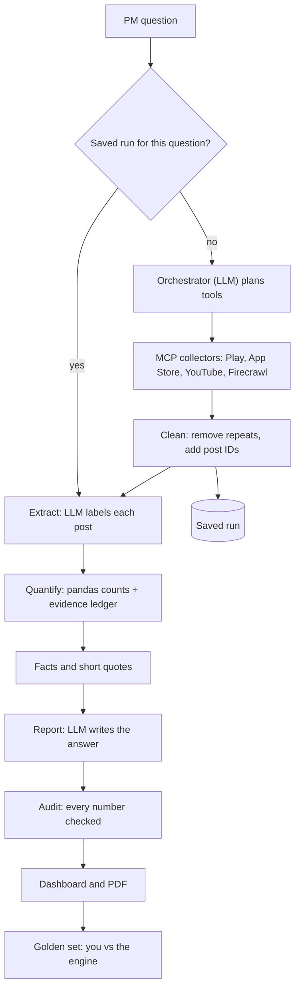
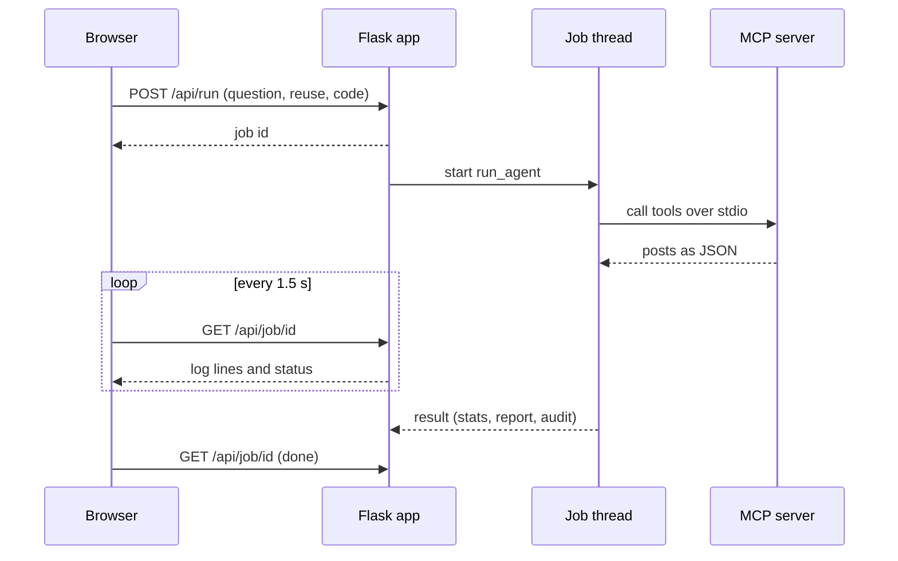
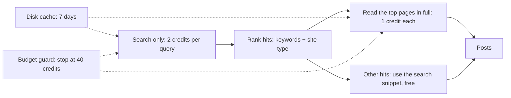

# Signal Desk: an AI discovery engine for first-time SIP investors

Signal Desk reads what people say publicly about a SIP (systematic investment plan) experience, sorts and counts it, and answers a product manager's question in plain language. Every number on the page can be clicked to see the original posts it was counted from.

It was built for one business goal: **raise the share of first-time mutual-fund investors who still have an active SIP 12 months after starting** (active = at least one successful instalment in the last 30 days). The product studied is Groww. This repository is the **discovery engine**. Interviews, the problem definition and the MVP use its output but are separate pieces of work.

| | |
|---|---|
| Live engine | [paste Vercel link] (backend on Render) |
| AI Evidence Log | [paste Google Doc / Claude Doc link] |
| Constraints from the brief | no specific fund or stock recommendations, no fear / FOMO / urgency language, nothing presented as investment advice |

---

## 1. Why this exists: the PM view

**Starting a SIP is easy; staying with it is the hard part.** Month-one intent is high, then life gets busy, the first statements look underwhelming, and some people pause, reduce or quietly stop. Growth cannot fix a problem it cannot see, and the people who drift away rarely tell the company why.

The engine's job is to find where public conversations point to friction or confusion, **count how often**, and show **which sites and posts** the evidence comes from, so a PM can decide what to investigate with real users.

### What the engine can and cannot answer

This table maps the brief's discovery questions to what public posts can actually support. The "cannot" column is the reason user interviews are part of the project.

| Brief question | Public posts can say | Limit |
|---|---|---|
| Why do people start, and what do they expect? | Partly (Quora, YouTube, forums) | People who *did* start rarely explain why |
| What changes in the months after starting? | Weakly | Reviews are snapshots, not timelines |
| What leads people to pause, reduce or stop? | Friction in the app (modify / skip / autopay / withdrawals) | The wish to stop is seldom written down |
| What do they check, and how often? | Almost nothing | Needs interviews |
| What confuses or worries them in the app? | **Yes**: strongest signal | Skews to unhappy reviewers |
| What do they do outside the app when unsure? | Some (Quora and forum questions, YouTube) | Anecdotal |
| What separates people who continue from those who quietly drop off? | **No** | Quiet drop-offs do not write reviews |
| Differences by segment (age, income, source of money, influence) | Only when the writer says it | None of the 83 posts analysed gave an age |
| Consistent unmet needs | Yes, as recurring themes | Counts are small |

Across the two research runs behind the evidence log, only **1 of 83 analysed posts** said what the writer did with their SIP. Reading that as "public data is not enough to explain continuation" is itself a finding.

---

## 2. Architecture


*Green boxes call a Groq LLM. Grey boxes are plain Python. Dashed gold outlines are new in this version. The editable vector is `docs/architecture.svg`.*

The system has one idea running through it: **the LLM never produces a number.** LLMs read and write words; ordinary code counts; and a separate check confirms the written summary matches what was counted.



### What changed from the first architecture

| Part | First version | This version |
|---|---|---|
| Entry | Question goes straight to the orchestrator | **Saved-run cache**: the same question re-uses collected data and spends 0 credits |
| Firecrawl | Searched and scraped every hit (up to about 55 credits per run) | **Search first, read only the best pages**, with a disk cache and a per-run credit budget (about 16 credits) |
| Clean data | Removed identical texts | Also removes **near-duplicate** posts, and gives every post a stable ID (E001, E002...) |
| Extract | Positive / neutral / negative, 12 topics | **Five kinds of neutral**, 16 topics, age band, experience, income, stated outcome, and a quoted **evidence phrase** that is checked against the original text |
| Quantify | Percentages with confidence ranges | Every figure is "k of n" tied to the exact posts and sites it came from (an **evidence ledger**), plus segments and a left-vs-stayed comparison |
| Report | Numbers-heavy summary and recommendations | **Plain-language answer** to the question, plain findings, **no recommendations** |
| Audit | One number check | Seven self-checks, a number-by-number trace to sources, and a banned-words check |
| Dashboard | Charts and PDF | Clickable numbers that open the original posts, an evidence explorer, and **golden-set export** |
| Deployment | Local only | Render (engine) + Vercel (dashboard) |

---

## 3. The workflow, step by step

### Step 0. A run starts
`POST /api/run` creates a job and returns an ID. The page polls `GET /api/job/<id>` every 1.5 seconds and shows the log as it grows. The job runs in a background thread, so a long run does not block the web server.



### Step 1. Saved-run cache
The question is normalised (lowercase, spaces collapsed) and hashed. If a run with the same hash was saved in the last `RUN_CACHE_DAYS` (default 3), its posts are reused and **no scraping happens**. This is what lets you tweak the report without spending Firecrawl credits. The page has a checkbox for it, ticked by default.

### Step 2. Orchestrator (LLM "brain")
A Groq model (`openai/gpt-oss-120b`) is shown the question and the list of collector tools and decides which to call and with which keywords. It runs up to three turns and may call tools in parallel. If it forgets a core collector, code fills the gap from a small known plan for Groww (Play Store `com.nextbillion.groww`, App Store `1404871703`). Keywords include English and Hinglish ("sip band kar diya", "paisa").

### Step 3. MCP collector server
Collectors are tools in a Model Context Protocol server (`mcp_server.py`), started as a subprocess over stdio. The brain discovers them at run time.

| Tool | Source | Notes |
|---|---|---|
| `play_store_reviews` | Google Play, India | `google-play-scraper`, up to 1,500 newest reviews, keyword-filtered. Free. |
| `app_store_reviews` | Apple App Store, India | iTunes RSS feed, 10 pages, keyword-filtered. Free. |
| `youtube_comments` | YouTube | `yt-dlp` finds videos for a query, `youtube-comment-downloader` reads comments. Free. |
| `source_sweep` | Open web via Firecrawl | One search per kind of site (below). Costs credits. |
| `web_search` | Open web via Firecrawl | One extra angle; reads the best 3 pages. |
| `scrape_url` | One page via Firecrawl | 1 credit. |
| `firecrawl_usage` | internal | Reports credits used; hidden from the brain. |

Every post leaves the collector with `source`, `site`, `url`, `date`, `rating` (when it has one) and `text`. **Excluded by design:** Reddit (needs approved API access), X, Facebook, Instagram and LinkedIn (login walls).

Default keyword filter: `sip`, `mutual fund`, `autopay`, `mandate`, `nav`, `xirr`, `invest`.

### Step 4. Firecrawl, built to spend as little as possible
Hosted Firecrawl charges **2 credits per search** (up to 10 results, no page content) and **1 credit per page read**. The sweep therefore searches first, ranks the hits, and reads only the best.



| Profile (`FIRECRAWL_PROFILE`) | Searches | Pages read in full | About |
|---|---|---|---|
| `lean` (default) | 5: Quora, MouthShut, Trustpilot, Hinglish queries, open web | 6 | 16 credits |
| `standard` | adds ConsumerComplaints, ValuePickr | 10 | 24 credits |
| `full` | adds TradingQ&A, Medium, Moneycontrol, News | 16 | 38 credits |

- **Ranking** scores each hit by keyword matches in its title and snippet, plus a bonus for sites where people write about their own experience (MouthShut, ConsumerComplaints, Trustpilot, Quora, forums).
- **Disk cache:** an identical Firecrawl call within `FIRECRAWL_CACHE_DAYS` (default 7) is answered from `.cache/firecrawl` for free.
- **Budget guard:** `FIRECRAWL_CREDIT_BUDGET` (default 40) is a hard stop per run. The agent keeps what it already collected.
- **Self-hosting:** set `FIRECRAWL_API_URL` to your own instance to spend no credits (use `FIRECRAWL_API_VERSION=v1` if your build has no v2; search needs a SearXNG endpoint configured on the Firecrawl side).
- TradingQ&A sits in `full` only, because its community guidelines discourage support and complaint posts.

### Step 5. Clean data
- **Exact repeats:** identical first 200 characters are dropped.
- **Near-duplicates:** a post is dropped if 60% or more of its 6-word phrases were already seen in a kept post (the same review captured twice).
- **Cap:** at most `MAX_DOCS` (default 200) posts, shared evenly across sources so no source dominates.
- **IDs:** every kept post gets a stable ID (`E001`...) used everywhere in the report.

### Step 6. Extract: an LLM labels each post
A smaller Groq model (`openai/gpt-oss-20b`) labels posts in batches of 8 (first 450 characters of each) and returns structured data only, never prose.

| Field | Values |
|---|---|
| relevant | about SIPs / investing, or not (not relevant posts are dropped) |
| feeling | positive, neutral, negative |
| kind of neutral | mixed, question, information/advice, lukewarm (a 3-star rating with no clear text becomes "3-star rating") |
| complaints / praise | any of 16 topics (below) |
| what the writer did | continuing, paused, stopped, not said |
| income | stable, irregular, unknown |
| age band | 18-27, 27-40, 40-55, 55+, unknown (27 belongs to 18-27, 40 to 27-40, 55 to 40-55) |
| how age was known | stated by the writer, or inferred from a life-stage cue (student, first job, kids, retirement) |
| experience | first-time, experienced, unknown |
| evidence phrase | up to 12 words **copied exactly** from the post that justify the feeling |

**16 topics:** autopay and mandates; trouble pausing, skipping or changing a SIP; withdrawals; statements and data mismatch; returns versus expectation; market falls; affordability; app bugs and crashes; ease of use; customer support; charges and fees; sign-up and KYC; choosing funds; goals and discipline; trust and safety; something else.

The code then checks that each evidence phrase really appears in the original text. A phrase that does not is discarded and counted in the self-checks.

### Step 7. Quantify (pandas, no LLM)
**What counts as satisfied, neutral and not satisfied**

| Class | Rule |
|---|---|
| Satisfied | 4 or 5 stars. With no stars: the writer is clearly positive about the product. |
| Neutral | 3 stars. With no stars: the writer does not clearly lean either way. |
| Not satisfied | 1 or 2 stars. With no stars: the writer is clearly negative. |

**Star rating wins when there is one.** It is the one thing the reviewer chose for themselves. The cost is that a 4-star review that complains still counts as satisfied. The golden-set check measures how often stars and text disagree so that effect is visible.

**The evidence ledger.** Every figure is stored as a *claim*, so nothing on the page is a bare percentage:

```json
{
  "label": "Trouble pausing, skipping or changing a SIP: complaints",
  "k": 6, "n": 12, "p": 50.0, "lo": 25.4, "hi": 74.6,
  "den": "12 not-satisfied posts",
  "ids": ["E003", "E009", "E014", "E021", "E027", "E031"],
  "sites": {"apps.apple.com": 4, "mouthshut.com": 2}
}
```

`p` is k/n; `lo`–`hi` is a 95% **Wilson interval** (the range the true share plausibly lies in; wide when n is small: 1 of 2 is 50%, but anywhere from 9.5% to 90.5%). `ids` are the exact posts counted and `sites` shows where they came from.

**What is computed**
- Overall and per-source split into satisfied / neutral / not satisfied, with the three adding up to the relevant total.
- The five kinds of neutral.
- Per-site table: posts read, about SIPs, split by class, and which search found them.
- Complaint topics (share of not-satisfied posts) and praise topics (share of satisfied posts).
- **Who stays and who leaves:** people who say they paused or stopped versus people who say they continue, complaint rate per topic in each group, and a plain verdict. Marked "hint only" until at least 5 people are on **both** sides.
- **Segments:** age bands, first-time versus experienced, income stability. A row under 30 posts is flagged "only a hint"; under 5 posts, "ignore the percentages". The page shows how many ages were stated versus inferred.
- Near-duplicates removed after labelling (same site, same evidence phrase).

### Step 8. Facts and quotes, then the Report (LLM)
Code turns the ledger into up to 34 pre-written **facts** such as "Customer support: 3 of 12 (25.0%) of the not-satisfied posts complain about it", plus up to 30 short **quotes** with their post IDs. The report writer sees only these and the PM's question, and returns JSON:

`headline`, `answer` (5 to 7 plain sentences), `key_points`, `findings` (title, detail, fact IDs, quote IDs), `what keeps people investing`, `why people leave`, `limitations`.

Its rules: plain English with no jargon or statistics terms; copy numbers exactly from the facts and never calculate new ones; never say people *want* to pause or stop unless a fact says so; say first when the data does not answer the question; **no recommendations, no specific funds or stocks, no fear or urgency wording**.

### Step 9. Audit
| Check | Passes when |
|---|---|
| Satisfied + neutral + not satisfied add up | they equal the relevant posts |
| Source rows add up | they equal the relevant posts |
| Neutral kinds add up | they equal the neutral total |
| Site rows add up | they equal the relevant posts |
| Evidence phrases exist word-for-word | at least 80% found in the original text |
| Stars and text agree (rated posts) | at least 70% agree |
| Posts link back to a page | at least 80% have a URL |
| Every number in the written summary | matches a computed figure |
| Banned wording (`last chance`, `hurry`, `miss out`, `fomo`, `limited time`, `act now`, `top fund`, `best fund`) | none found |

The audit also builds a **number trace**: each percentage and "k of n" in the summary is matched to the claims (and sites) it came from, shown under "Where each number in the summary comes from".

### Step 10. Dashboard and PDF
Sections, in order: the question and the short answer; headline numbers; how posts were sorted (including what is inside "neutral"); satisfaction by source and by site; why users are not satisfied and what satisfied users like; who stays and who leaves; segments; findings; method, checks and number trace; the golden-set downloads; and an **evidence explorer** that lists every post with its labels. Clicking any number opens the original posts behind it, with the site, link, date, stars and the highlighted evidence phrase. The same content downloads as a PDF.

### Step 11. Golden set: checking the engine against you
At the bottom of the dashboard:
1. **Blank sheet:** 20 posts drawn at random (fixed seed, spread across sites, repeats excluded) with empty columns for your own labels.
2. Label them by hand **before** opening the second file.
3. **Engine answers:** the engine's labels for the same 20 posts.
4. Run `python tools/golden_agreement.py golden_sheet.csv golden_engine.csv`. It prints agreement for relevance, feeling (with a confusion matrix and kappa), kind of neutral, complaint and praise topics, and stated outcome; how often the star rating disagrees with the text; and every disagreement to explain in the evidence log.

---

## 4. Data model

**A post** (after collection, before labelling)
```json
{"id": "E012", "source": "app_store", "site": "apps.apple.com", "text": "Unable to modify SIP. Now migrating to zerodha",
 "rating": 1, "date": "2026-10-31", "url": "https://...", "context": "App Store review (India)", "tool": "app_store_reviews"}
```
Web posts also carry `via` (which search found them) and `how` (`page` if the full page was read, `snippet` if only the search snippet was used).

**The result of a run** is one JSON object: `query`, `trace` (tools called), `coverage` (sites), `credits`, `stats` (counts, claims, items, checks, warnings), `facts`, `quotes`, `report`, `audit`.

---

## 5. Repository layout

```
agent.py              orchestrator, labelling, quantification, facts, report, audit
mcp_server.py         MCP collectors (Play, App Store, YouTube, Firecrawl) + credit meter, cache, budget
app.py                Flask API, job runner, access code, PDF, golden-set downloads
static/index.html     dashboard page
static/app.js         dashboard logic and the evidence drawer
static/style.css      dashboard styles
static/vercel.json    Vercel: forwards /api/* to the Render backend
tools/golden_agreement.py   golden-set agreement script
docs/architecture.png|svg   architecture diagram
render.yaml           Render blueprint (one gunicorn worker)
requirements.txt  .env.example  .gitignore  README.md
```

---

## 6. Run it locally

```bash
python3 -m venv .venv && source .venv/bin/activate     # Windows: .venv\Scripts\activate
pip install -r requirements.txt
cp .env.example .env                                   # add GROQ_API_KEY and FIRECRAWL_API_KEY
python app.py                                          # http://localhost:5000
```

### Settings (`.env`)

| Variable | Default | Meaning |
|---|---|---|
| `GROQ_API_KEY` | none | required |
| `FIRECRAWL_API_KEY` | none | required for the open-web sources (app stores and YouTube still run without it) |
| `FIRECRAWL_PROFILE` | `lean` | `lean`, `standard` or `full` |
| `FIRECRAWL_CREDIT_BUDGET` | `40` | hard stop per run |
| `FIRECRAWL_CACHE_DAYS` | `7` | how long identical Firecrawl calls are reused |
| `RUN_CACHE_DAYS` | `3` | how long a saved run is reused for the same question |
| `FIRECRAWL_CONCURRENCY` | `2` | parallel Firecrawl requests |
| `FIRECRAWL_API_URL`, `FIRECRAWL_API_VERSION` | hosted, `v2` | point at a self-hosted Firecrawl |
| `BRAIN_MODEL`, `EXTRACT_MODEL` | `openai/gpt-oss-120b`, `openai/gpt-oss-20b` | Groq models |
| `MAX_DOCS` | `200` | posts analysed per run |
| `ACCESS_CODE` | empty | if set, fresh runs need it (re-runs of saved questions stay open) |
| `HOST`, `PORT` | `127.0.0.1`, `5000` | local server (Render sets `PORT`) |

### API

| Endpoint | Purpose |
|---|---|
| `GET /` | dashboard |
| `POST /api/run` | start a run: `{query, reuse, code}` returns `{id}` |
| `GET /api/job/<id>` | status, log and the result when done |
| `GET /api/pdf/<id>` | PDF report |
| `GET /api/golden/<id>/sheet.csv`, `/engine.csv` | golden-set files |
| `GET /api/config` | tells the page whether an access code is needed |
| `GET /healthz`, `/api/healthz` | health check |

---

## 7. Deployment

**Why two hosts.** A run lasts minutes and keeps its progress in memory, so it needs a long-lived server. Vercel runs Python only as short per-request functions with no shared memory, so the engine runs on **Render** and Vercel serves only the static dashboard.

1. **Render:** New, then Blueprint, pick this repo; it reads `render.yaml` (one gunicorn worker on purpose, since job progress lives in memory). Set `GROQ_API_KEY`, `FIRECRAWL_API_KEY` and `ACCESS_CODE`.
2. Open `https://<your-service>.onrender.com/healthz`; it should answer `{"ok":true}`.
3. Put that host into `static/vercel.json` (the `/api/:path*` destination), commit and push.
4. **Vercel:** Add New Project, import the repo, set **Root Directory** to `static`, framework "Other", no build command. `vercel.json` forwards `/api/*` to Render, so no CORS setup is needed.

Free-tier notes: Render sleeps after 15 minutes idle (the first request takes about a minute) and forgets saved runs when it restarts, so re-run key questions with the access code before a demo.

---

## 8. Design decisions

- **Numbers come from code, words come from LLMs.** It makes every figure checkable and stops the model inventing statistics.
- **Every claim carries its evidence.** A PM can click a percentage and read the posts instead of trusting a summary.
- **Honest about small samples.** Counts are shown as "k of n" with ranges, small groups are flagged, and the report must say when the data does not answer the question.
- **Stars win over text** for rated posts, and the golden set measures that choice instead of hiding it.
- **Lean by default.** Credits are limited, so the cheapest sweep that still covers review sites, Q&A and Hinglish discussion is the default.
- **Reddit left out.** It needs approved API access, and unauthorised scraping goes against its terms.

## 9. Known limitations

- Public reviews are a **self-selected sample**: they describe people who chose to write, not all users.
- **Quiet drop-offs are invisible.** Only about 1 in 83 analysed posts said what the writer did with their SIP, so continuation cannot be read from this data.
- **Volume is modest** (tens of posts per run) because the default sweep is credit-capped.
- Age, income and experience are mostly unstated, so segment rows are thin; inferred ages are marked as inferred.
- Coverage gaps against the brief's source list: Reddit and TradingQ&A (default sweep), and social networks. The YouTube collector returned nothing in the two evidence runs and needs a cause check.
- The labeller can be wrong (see the evidence log). The golden-set agreement score is the measure of how often.
- The free Render tier forgets saved runs on restart.

## 10. Responsible use

Only public posts are read; no accounts, PAN, account numbers or screenshots are collected. Original posts are linked, not rehosted as a database. Nothing the engine writes is investment advice, and the report writer is instructed not to name funds or use pressure language.

## 11. Where this fits in the wider project

| Brief part | Where it lives |
|---|---|
| 1. Discovery engine, 1-slide explanation | this repo, plus `docs/architecture.png` |
| 2. Metric breakdown, 4. problem definition | uses the dashboard output together with the interviews |
| 3. Interviews | separate; they cover what public data cannot (checking behaviour, quiet drop-off, segments) |
| 5. MVP, 6. user testing, 7. success metrics, 8. risks | separate |
| AI Evidence Log | sources and volume, golden set, corrected AI output |
